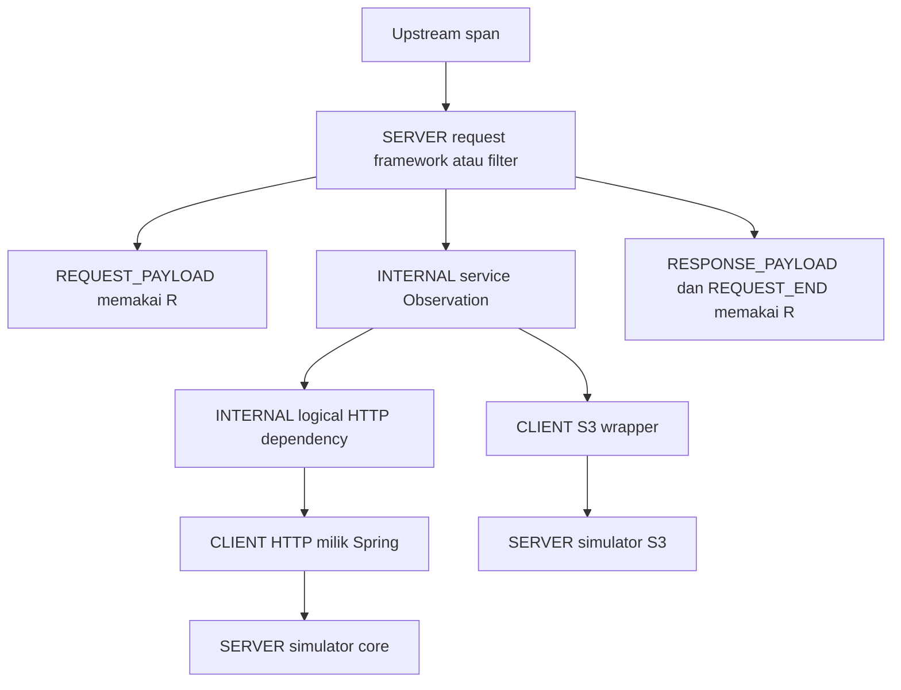

# Trace ID dan span ID

[Library](README.md) · [Kontrak schema 3 dan migrasi](ENTERPRISE-LOGGING.md) · [Flow kompleks](../examples/insurance-crud/COMPLEX-FLOW.md) · [HTTP examples](../examples/insurance-crud/requests.http)

## Kontrak aktif — schemaVersion 3

| Field | Makna |
|---|---|
| traceId | Alur lintas service, 32 hex lowercase nonzero |
| spanId | Pekerjaan dalam trace, 16 hex lowercase nonzero |
| parentSpanId | Span pemanggil; tidak ada pada root tanpa upstream |
| operation | Nama pekerjaan stabil, bukan input pengguna |
| spanKind | SERVER, INTERNAL, CLIENT, atau CONSUMER untuk job scope |

OpenTelemetry SDK mengelola span, ID, sampling dan scope; W3C propagator standar menangani header. Spring menggunakan instance OpenTelemetry yang sama dengan Micrometer dan ObservationRegistry. ThreadLocal library hanya menyimpan metadata operasi dan ownership error, bukan engine tracing sendiri.



Semua node memiliki traceId sama. Jika request tidak memiliki upstream, SDK membuat trace baru per request meskipun user sama. Jika framework sudah membuka SERVER span, filter menggunakannya dan tidak mengakhirinya sendiri. Filter membuat/mengakhiri SERVER span hanya saat belum ada span framework.

## HTTP propagation

Gunakan satu header W3C:

```http
traceparent: 00-4bf92f3577b34da6a3ce929d0e0e4736-00f067aa0ba902b7-01
```

Request SERVER span menjadi child remote span, bukan memakai ulang spanId remote. Invalid header menghasilkan root baru sesuai propagator standar. Jangan memakai traceId sebagai autentikasi atau identitas user. Request `X-Trace-ID` bukan sumber context; response `X-Trace-ID` dan `X-Span-ID` membantu pencarian.

Boot RestClient/RestTemplate builder plus actuator/Micrometer bridge membuat CLIENT span dan mengirim W3C context. Gunakan `DependencyLogging.callHttp` untuk scope logis di atasnya. `call` empat argumen membuat CLIENT span bagi SDK tanpa instrumentasi; adapter S3 memasang `tLog.traceparent()` secara eksplisit. Interceptor legacy tidak lagi otomatis dipasang dan `propagation-hosts` hanya berlaku bila interceptor itu dipasang manual.

## Job dan executor

```java
try (TraceScope job = tLog.withTrace(null)) {
    try (LogOperation process = tLog.start("job.process")) {
        try {
            processBatch();
            process.end();
        } catch (RuntimeException ex) {
            process.fail(ex);
            tExceptionLog.error(process.context(), ex);
            throw ex;
        }
    }
}
```

`withTrace(null)` membuka real SDK CONSUMER span `trace.scope` dan menutupnya di akhir job, sehingga operasi berurutan tetap satu trace. Root tanpa scope juga otomatis dibuat saat `start`. Gunakan operation/job scope eksplisit untuk kelompok pekerjaan.

`withTrace(existingTraceId)` dipertahankan untuk caller tepercaya sebagai compatibility bridge; karena input itu tidak menyertakan remote span, SDK menggunakan seed parent. Untuk distributed tracing pakai full `withTraceparent(header)`; API itu membuka context remote dan `start` pertama menjadi SERVER child. Jangan memakai traceId saja untuk propagasi HTTP.

`propagate(Runnable)` menangkap standard OTel context dan metadata. Worker memasang snapshot kemudian memulihkan scope/MDC dalam finally. Task yang mencatat proses sendiri membuka child operation. Pemanggil bertanggung jawab pada lifecycle/cancellation dan error boundary executor. Future/reactive/@Async tidak otomatis ditangani aspect synchronous.

MDC traceId/spanId/parentSpanId dipulihkan saat close. Error boundary dapat memakai span operasi yang gagal setelah scope service tertutup lewat failure context; satu pemilik boundary mencatat stack trace. Span milik common menyimpan error.type tanpa raw exception message/event. Instrumentasi HTTP/framework lain memiliki kebijakan telemetry sendiri; review/redaksi exporter sebelum mengirim telemetry produksi.

Async/error servlet dispatch menggunakan request state yang sama dan completion idempotent. Dukungan lifecycle diuji melalui mock servlet; deployment servlet container nyata tetap perlu pilot.

Verifikasi exporter in-memory pada test memastikan log span benar-benar ada di SDK, parent HTTP CLIENT berada di bawah logical scope, dan root server tidak diduplikasi. Export OTLP dinonaktifkan pada local example; tidak ada klaim sudah diuji pada collector kantor.
