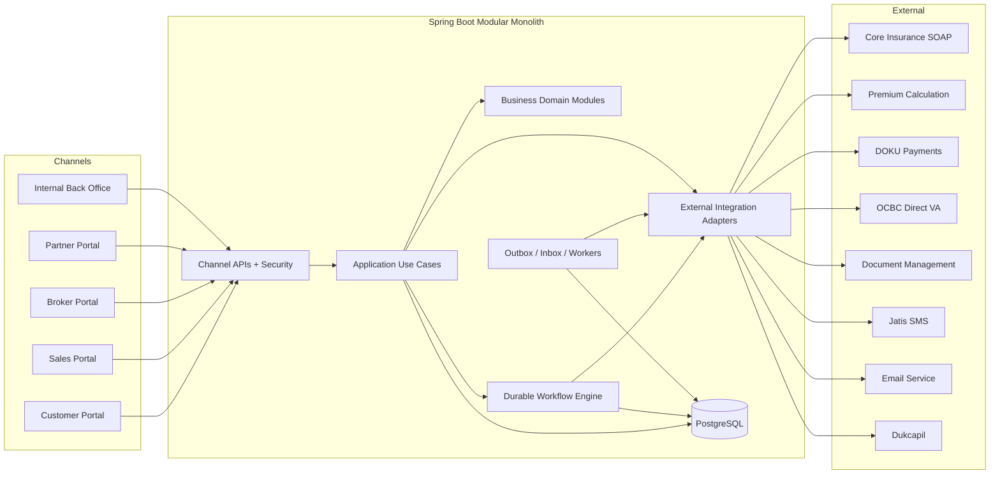
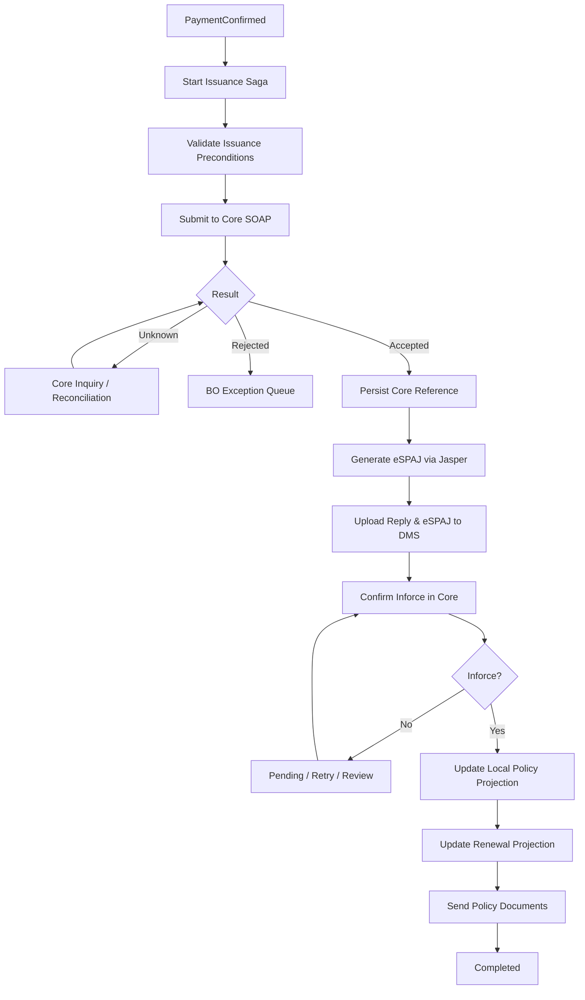
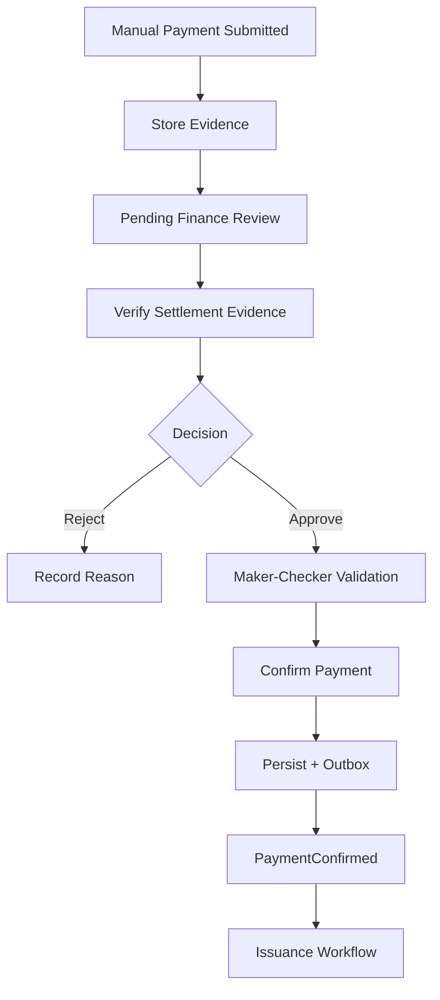

Bor, gua rangkum seluruh keputusan kita menjadi Insurance Business Platform — Architecture Blueprint v1.0. Ini bisa lu jadikan master specification untuk AI coding agent, supaya agent punya acuan yang konsisten ketika membangun modul, use case, database, integrasi, sampai testing.

Gua akan pisahkan antara keputusan yang sudah final, rekomendasi implementasi, dan hal yang masih membutuhkan konfirmasi bisnis. Tujuannya supaya agent tidak mengarang business rule atau kontrak API eksternal.

# Insurance Business Platform

Enterprise Architecture Blueprint v1.0 · Spring Boot · Clean Architecture · Use Case Driven

## 1. Architecture decisions

| Area                   | Keputusan                                                         |
| ---------------------- | ----------------------------------------------------------------- |
| Architecture style     | Modular Monolith                                                  |
| Application framework  | Spring Boot                                                       |
| Architecture pattern   | Clean Architecture + Hexagonal Ports & Adapters                   |
| Module organization    | Business domain first, use case based                             |
| Module boundaries      | Spring Modulith                                                   |
| Transaction management | Local ACID + Transactional Outbox                                 |
| Long-running process   | Durable Saga Orchestration                                        |
| Integration pattern    | Synchronous API + asynchronous events                             |
| Core Insurance         | Authoritative System of Record                                    |
| Local database         | Operational Store + Core Projections + Read Models                |
| Data access            | JPA for transactional writes, SQL projections for complex queries |
| API                    | REST for portals, provider-specific webhook/inquiry endpoints     |
| Authorization          | RBAC + permission + data scope + maker-checker                    |
| Observability          | Distributed tracing, metrics, structured logs, audit              |
| Testing                | Unit, architecture, integration, contract, workflow tests         |

Arsitektur yang dipilih bukan microservices-first. Satu Spring Boot application dapat menangani semua modul dengan ownership yang jelas. Modul yang nantinya membutuhkan deployment atau scaling independen dapat diekstrak jika benar-benar diperlukan.

## 2. Application scope

Customer

Proposal, rider, fund, payment, policy, claim

Sales

Leads, proposals, production, referral

Broker

Broker proposals, commission, performance

Partner

Registration, approval status, sales

Back Office

Internal approvals, reporting, operations

External Systems

Core, DOKU, OCBC, DMS, Jatis, Dukcapil

BO hanya untuk pegawai internal. Broker dan partner eksternal tidak diberi akses ke BO, meskipun sebagian proses bisnis mereka menggunakan use case yang sama.

## 3. Bounded contexts dan module ownership

| Module            | Owns                                                         |
| ----------------- | ------------------------------------------------------------ |
| `newbusiness`     | Proposal, applicant snapshot, submission lifecycle           |
| `product`         | Product configuration, eligibility, rider rules              |
| `payment`         | Payment order, attempt, transaction, mandate, reconciliation |
| `policy`          | Policy servicing requests dan Core policy projection         |
| `claim`           | Claim request, documents, approval, status                   |
| `fund`            | Fund allocation dan investment-related requests              |
| `document`        | Document metadata, generation, storage references            |
| `notification`    | Email, SMS, OTP delivery tracking                            |
| `verification`    | OTP challenge, verification, expiry, attempt limits          |
| `partner`         | Partner registration, onboarding, approval status            |
| `broker`          | Broker hierarchy, assignment, referral                       |
| `commission`      | Commission rule, accrual, payout                             |
| `approval`        | Reusable approval tasks, maker-checker, escalation           |
| `renewal`         | Renewal schedule, collection workflow, status projection     |
| `reporting`       | Report definitions, jobs, generated artifacts                |
| `operations`      | Recovery, reconciliation, integration history                |
| `workflow`        | Durable cross-module business process orchestration          |
| `coreintegration` | Shared SOAP transport, authentication, fault handling        |

Ownership berarti module lain tidak boleh langsung mengubah database table internal module tersebut.

Cross-module communication: public application interface untuk request synchronous, domain/integration event untuk asynchronous propagation.

## 4. High-level architecture



JasperReports berjalan sebagai document generation adapter atau worker. Semua external client menggunakan timeout, bounded retry, correlation ID, error classification, dan circuit breaker jika sesuai.

## 5. Recommended project structure

```
insurance-platform/
├── pom.xml
├── README.md
├── AGENTS.md
├── docs/
│   ├── architecture/
│   │   ├── overview.md
│   │   ├── module-boundaries.md
│   │   ├── data-ownership.md
│   │   ├── security.md
│   │   └── adr/
│   ├── workflows/
│   │   ├── newbusiness.md
│   │   ├── payment.md
│   │   ├── issuance.md
│   │   ├── renewal.md
│   │   └── manual-payment.md
│   ├── integrations/
│   │   ├── core-soap.md
│   │   ├── doku-dipc.md
│   │   ├── doku-card.md
│   │   ├── ocbc-va.md
│   │   ├── dukcapil.md
│   │   └── document-management.md
│   └── contracts/
│       ├── api/
│       └── events/
├── src/main/java/com/fq/insurance/
│   ├── InsuranceApplication.java
│   ├── channel/
│   │   ├── customer/
│   │   ├── sales/
│   │   ├── broker/
│   │   ├── partner/
│   │   ├── backoffice/
│   │   └── webhook/
│   ├── newbusiness/
│   ├── product/
│   ├── payment/
│   ├── policy/
│   ├── claim/
│   ├── fund/
│   ├── document/
│   ├── notification/
│   ├── verification/
│   ├── partner/
│   ├── broker/
│   ├── commission/
│   ├── approval/
│   ├── renewal/
│   ├── reporting/
│   ├── operations/
│   ├── workflow/
│   ├── coreintegration/
│   └── shared/
├── src/main/resources/
│   ├── application.yml
│   ├── db/migration/
│   └── reports/
└── src/test/
```

### Internal structure per module

```
payment/
├── package-info.java
├── api/
│   ├── PaymentFacade.java
│   └── PaymentEvents.java
├── application/
│   ├── usecase/
│   ├── command/
│   ├── query/
│   ├── service/
│   └── port/
│       ├── in/
│       └── out/
├── domain/
│   ├── model/
│   ├── valueobject/
│   ├── rule/
│   ├── event/
│   └── exception/
└── infrastructure/
    ├── persistence/
    ├── doku/
    ├── ocbc/
    └── configuration/
```

Gunakan Spring Modulith untuk memverifikasi dependency boundary. `api/` adalah interface publik antarmodul, bukan REST controller. REST controller tetap di `channel/`.

## 6. Dependency rules

Inbound Adapters

REST Controllers · Webhooks · Scheduled Workers

Application Layer

Use Cases · Orchestration · Ports · Transaction Boundaries

Domain Layer

Entities · Value Objects · Domain Rules · State Transitions

Outbound Infrastructure

Implements application ports: JPA · SOAP · HTTP · File Storage

Rules untuk agent:

- Domain tidak boleh mengimpor Spring, JPA, Feign, SOAP-generated classes, atau HTTP DTO.
- Application boleh menggunakan transaction abstraction dan ports, tetapi tidak mengimpor concrete adapters.
- Infrastructure mengimplementasikan outbound ports.
- Controller tidak boleh langsung memanggil repository atau external integration.
- Cross-module calls hanya lewat public facade atau published events.
- Jangan membuat generic `BaseUseCase`, `BaseRepository`, atau `CommonService` tanpa kebutuhan nyata.
- Jangan membuat abstraction hanya demi abstraction. Class kecil yang jelas lebih baik daripada puluhan interface tanpa manfaat.

## 7. Detailed New Business specification

### 7.1 Submission stages

| Step | Operation                                  | Failure behavior                    |
| ---- | ------------------------------------------ | ----------------------------------- |
| 1    | Validate required fields, patterns         | Reject 400/422                      |
| 2    | Validate product eligibility               | Reject with business error          |
| 3    | Validate NIK restriction and identity      | Reject or mark verification pending |
| 4    | Validate postal code                       | Reject or request correction        |
| 5    | Recalculate premium via internal service   | Reject mismatched quote             |
| 6    | Generate internal proposal reference       | Idempotent generation               |
| 7    | Store KTP securely                         | Cleanup on failure                  |
| 8    | Persist proposal as LEAD                   | Database transaction                |
| 9    | Create OTP challenge and outbox            | Atomic with DB transaction          |
| 10   | Dispatch OTP SMS/email and acknowledgement | Async retry                         |
| 11   | Verify OTP                                 | Enforce expiry and attempt limit    |
| 12   | Mark OTP_VERIFIED                          | Conditional state transition        |
| 13   | Enable payment initiation                  | Create payment order                |

`LEAD` adalah status proposal lokal, bukan status polis resmi.

### 7.2 Sample files

```
newbusiness/application/
├── usecase/
│   ├── SubmitProposalUseCase.java
│   ├── VerifyProposalUseCase.java
│   ├── GetProposalUseCase.java
│   └── CancelProposalUseCase.java
├── service/
│   ├── ProposalSubmissionService.java
│   ├── ProposalValidationService.java
│   └── ProposalTransactionService.java
├── port/out/
│   ├── ProposalRepository.java
│   ├── ProductRequirementPort.java
│   ├── PremiumCalculationPort.java
│   ├── IdentityVerificationPort.java
│   └── DocumentStoragePort.java
└── command/
    └── SubmitProposalCommand.java
```

### 7.3 Use case contract

```
public interface SubmitProposalUseCase {
    ProposalResult execute(
        SubmitProposalCommand command
    );
}
```

```
public record SubmitProposalCommand(
    String productCode,
    ApplicantData applicant,
    List<RiderSelection> riders,
    FundSelection fund,
    BigDecimal expectedPremium,
    String quoteReference,
    String idempotencyKey,
    DocumentUpload ktp
) {}
```

### 7.4 Validation strategy

Gunakan tiga lapisan validasi:

Request: Bean Validation untuk format, required fields, length, dan constraints dasar.

Domain: product eligibility, age restrictions, rider compatibility, fund allocation percentage, dan policy business rules.

External: Dukcapil, restricted NIK, postal code master, premium calculation.

Untuk kalkulasi, backend wajib menggunakan hasil authoritative dari calculation service. Jangan mempercayai nominal dari FE. Simpan quote reference, product/rate version, calculation result, dan expiration agar pembayaran tidak menggunakan premi yang sudah kedaluwarsa.

## 8. Payment specification

### Payment channels

| Method              | Provider               | Operations                                     |
| ------------------- | ---------------------- | ---------------------------------------------- |
| Virtual Account     | DOKU DIPC              | Payment reference, inquiry, notification       |
| Virtual Account     | OCBC Direct            | VA lifecycle dan callback sesuai kontrak OCBC  |
| Credit Card         | DOKU                   | Payment, tokenization bila tersedia            |
| Recurring Card      | DOKU                   | Mandate/token, charge, cancellation            |
| Recurring Deduction | Provider sesuai produk | Collection schedule, deduction, reconciliation |
| Manual Payment      | Internal BO            | Evidence, review, approval, confirmation       |

DOKU DIPC integration: agent wajib memverifikasi dokumentasi resmi dan kontrak merchant/bank yang aktif sebelum implementasi. Jangan menganggap DIPC sama dengan DGPC/MGPC atau menyamakan semua bank VA. Dokumentasi utama: [DOKU SNAP Virtual Account](https://developers.doku.com/accept-payments/direct-api/snap/integration-guide/virtual-account?utm_source=chatgpt.com).

### Required payment entities

```
PaymentOrder
PaymentAttempt
PaymentTransaction
PaymentNotificationInbox
PaymentMandate
PaymentReconciliation
ManualPaymentEvidence
```

### Required invariants

- Payment order dibuat hanya untuk proposal yang memenuhi payment eligibility.
- Satu proposal boleh mempunyai beberapa payment attempts.
- Callback duplikat tidak boleh menyebabkan issuance ganda.
- Callback valid tetap harus dicocokkan dengan order, nominal, currency, dan merchant reference.
- Callback HTTP acknowledgement dipisahkan dari downstream issuance.
- Timeout dari provider bukan otomatis gagal.
- Unknown payment status harus direkonsiliasi.
- Payment method tidak menentukan status polis resmi.
- Token kartu dan mandate dikelola sesuai persyaratan provider dan PCI DSS yang berlaku.

### Payment status

```
CREATED
PENDING
PAID
FAILED
EXPIRED
CANCELLED
REFUNDED
```

Gunakan payment attempt dan transaction record untuk menangani callback terlambat, multiple attempts, partial payment jika diperbolehkan, refund, dan chargeback. Jangan mengubah `PAID` menjadi `FAILED` hanya karena callback lama datang belakangan.

## 9. Policy issuance specification



Workflow order perlu configurable karena beberapa produk mungkin membutuhkan underwriting, approval, atau dokumen sebelum aktivasi. Core tetap pemilik status polis.

### Issuance files

```
workflow/issuance/
├── PolicyIssuanceWorkflow.java
├── IssuanceWorkflowState.java
├── step/
│   ├── CheckIssuanceEligibilityStep.java
│   ├── SubmitPolicyToCoreStep.java
│   ├── GenerateEspajStep.java
│   ├── UploadDocumentsStep.java
│   ├── ConfirmCoreStatusStep.java
│   ├── SynchronizePolicyStep.java
│   ├── SynchronizeRenewalStep.java
│   └── SendPolicyEmailStep.java
└── recovery/
    └── IssuanceRecoveryHandler.java
```

Semua external side effects harus idempotent atau memiliki inquiry/reconciliation sebelum retry. `COMPLETED` berarti seluruh mandatory step terpenuhi; kegagalan email non-kritis boleh diretry terpisah tanpa membatalkan polis yang sudah Inforce.

## 10. Core Insurance integration & local data strategy

Core Insurance adalah source of truth untuk polis, sedangkan Spring Boot menyimpan operational data dan projection agar tidak perlu melakukan SOAP inquiry setiap kali ada request.

### Data ownership

| Data                      | Authoritative owner              | Local treatment               |
| ------------------------- | -------------------------------- | ----------------------------- |
| Proposal / Leads          | Insurance Platform               | Transactional                 |
| OTP / Verification        | Insurance Platform               | Transactional, secured        |
| Payment order             | Insurance Platform               | Transactional                 |
| Provider settlement       | Payment provider/bank            | Verified transaction snapshot |
| Policy number / status    | Core Insurance                   | Local projection              |
| Policy coverage / rider   | Core Insurance                   | Local projection              |
| Renewal due date          | Core Insurance                   | Local projection              |
| Claims                    | Bergantung core claim capability | Local workflow + projection   |
| Broker / partner approval | Insurance Platform               | Transactional                 |
| BO reports                | Insurance Platform               | Derived read models           |

### Local policy projection

```
CREATE TABLE policy_projection (
    id UUID PRIMARY KEY,
    core_policy_number VARCHAR(64) UNIQUE NOT NULL,
    proposal_id UUID,
    product_code VARCHAR(64),
    policy_status VARCHAR(40),
    premium_amount NUMERIC(19,2),
    next_due_date DATE,
    effective_date DATE,
    core_version VARCHAR(100),
    core_updated_at TIMESTAMPTZ,
    last_synced_at TIMESTAMPTZ,
    sync_status VARCHAR(30) NOT NULL,
    created_at TIMESTAMPTZ NOT NULL,
    updated_at TIMESTAMPTZ NOT NULL
);
```

`core_version` dan `core_updated_at` hanya diisi jika memang tersedia dari Core.

### Synchronization strategies

- After-write refresh: setelah perubahan ke Core berhasil, update projection dari authoritative response atau inquiry.
- Event-triggered refresh: setelah issuance, policy servicing, atau renewal.
- Scheduled reconciliation: untuk polis pending, stale, atau memiliki ketidaksesuaian.
- On-demand refresh: untuk BO yang punya permission dan operasi yang membutuhkan data fresh.
- Bulk/incremental sync: hanya jika kontrak SOAP Core mendukung.

Simpan `last_synced_at`, `sync_status`, source fingerprint/version jika tersedia, dan error terakhir. Dashboard boleh menggunakan eventual consistency, tetapi keputusan bisnis kritikal harus mengikuti freshness policy yang lebih ketat.

Gunakan anti-corruption layer untuk mengubah SOAP-generated DTO menjadi domain-neutral response.

```
policy/application/port/out/
└── CorePolicyPort.java

policy/infrastructure/core/
├── CorePolicySoapAdapter.java
├── CorePolicyMapper.java
└── CorePolicyFaultTranslator.java

coreintegration/infrastructure/soap/
├── CoreSoapClientConfiguration.java
├── CoreAuthenticationInterceptor.java
└── SoapFaultClassifier.java
```

Jangan membocorkan JAXB, WSDL, atau SOAP fault class ke application/domain layer.

## 11. Back Office specification

BO adalah internal-only channel yang menggunakan domain use case, bukan module yang memiliki semua business logic.

### BO capabilities

| Area         | Use cases                                                      |
| ------------ | -------------------------------------------------------------- |
| Dashboard    | Production, leads, policy, claims, payment, SLA                |
| Payment      | Manual approval, reconciliation, payment investigation         |
| New Business | Proposal review, correction request, rejection                 |
| Policy       | Policy inquiry, servicing review, issuance investigation       |
| Claims       | Claim review, approval, document verification                  |
| Document     | View reply/eSPAJ/history, regenerate, re-upload                |
| Partner      | Onboarding approval, suspension, activation                    |
| Reporting    | Generate, download, schedule reports                           |
| Operations   | Retry workflow, Core sync, failed callback investigation       |
| Audit        | View approval history, sensitive actions, integration timeline |

### Manual payment approval



Required controls: authenticated approver, permission check, maker-checker, immutable audit, evidence verification, optimistic/pessimistic locking, and duplicate approval protection.

### Dashboard & reporting

Gunakan CQRS ringan. Dashboard membaca local read models, bukan memanggil Core SOAP per widget.

```
reporting/
├── application/usecase/
│   ├── GenerateReportUseCase.java
│   ├── GetReportStatusUseCase.java
│   ├── DownloadReportUseCase.java
│   └── ScheduleReportUseCase.java
├── application/port/out/
│   ├── ReportDataPort.java
│   ├── ReportRendererPort.java
│   └── ReportStoragePort.java
├── domain/
└── infrastructure/
    ├── query/
    ├── jasper/
    └── persistence/
```

Report besar diproses async. Simpan job status, parameter, peminta, scope data, storage reference, expiry, dan audit download. JasperReports tidak boleh menjalankan query tidak terbatas ke database transaksi saat jam sibuk.

## 12. Security & authorization

Untuk platform ini, gua sarankan:

- Internal BO menggunakan corporate SSO, MFA, dan restricted network/gateway.
- Customer, Sales, Broker, Partner menggunakan authentication realm/client policy sesuai channel.
- Spring Security memverifikasi JWT/OIDC dan permissions.
- Authorization mencakup role, permission, business unit, branch, broker hierarchy, dan record ownership.
- Approval menggunakan maker-checker dan separation of duties.
- PII dan dokumen sensitif dienkripsi saat disimpan dan dikirim.
- NIK, KTP, data kesehatan, OTP, payment token, dan SOAP payload sensitif tidak boleh muncul di application log.
- Setiap perubahan finansial, policy status, approval, report export, dan retry operational memiliki audit record.
- Access to local policy projections tetap dibatasi berdasarkan hak akses user, bukan karena data sudah ada di database lokal.

Contoh permissions:

```
PROPOSAL_CREATE
PROPOSAL_VIEW
PROPOSAL_REVIEW
PAYMENT_VIEW
PAYMENT_MANUAL_SUBMIT
PAYMENT_APPROVE
PAYMENT_RECONCILE
POLICY_VIEW
POLICY_SERVICE_REQUEST
CLAIM_REVIEW
CLAIM_APPROVE
REPORT_GENERATE
REPORT_DOWNLOAD
WORKFLOW_VIEW
WORKFLOW_RETRY
CORE_SYNC_TRIGGER
PARTNER_APPROVE
AUDIT_VIEW
```

## 13. Reliability, event processing, dan workflow

### Outbox

Saat transaksi bisnis berhasil, simpan business state dan outbox event dalam satu database transaction.

```
outbox_event
------------
id
event_type
aggregate_type
aggregate_id
payload
status
attempt_count
next_attempt_at
created_at
published_at
```

Event publisher berjalan setelah commit. Consumer wajib idempotent karena event dapat dikirim lebih dari sekali.

### Inbox

Untuk webhook DOKU, OCBC, dan event eksternal:

```
inbox_event
-----------
id
provider
provider_event_id
business_reference
payload_reference
received_at
processed_at
status
```

Gunakan deduplication key yang stabil. Jangan mengandalkan provider event ID jika provider tidak menjaminnya unik; gunakan kombinasi identitas transaksi dan event yang telah diverifikasi.

### Workflow execution

```
workflow_instance
workflow_step_execution
workflow_retry_schedule
workflow_failure
```

Required capabilities:

- Durable state persistence
- Step retry with exponential backoff
- Timeout handling
- Idempotency
- Unknown-result reconciliation
- Manual intervention
- Audit and trace correlation
- Dead-letter / exception handling
- Safe workflow resume

Jangan menjalankan Core SOAP call, DOKU callback processing, Jasper generation, dan DMS upload dalam satu transaksi database.

## 14. API contract conventions

Gunakan endpoint berbasis resource dan action yang eksplisit ketika business operation memang berupa command.

```
# Customer
POST /api/customer/v1/proposals
GET  /api/customer/v1/proposals/{id}
POST /api/customer/v1/proposals/{id}/otp-verifications
POST /api/customer/v1/proposals/{id}/payments

# Back Office
GET  /api/backoffice/v1/dashboard
GET  /api/backoffice/v1/proposals
GET  /api/backoffice/v1/payments/manual
POST /api/backoffice/v1/payments/{id}/approval-decisions
POST /api/backoffice/v1/reports
GET  /api/backoffice/v1/reports/{id}
GET  /api/backoffice/v1/workflows
POST /api/backoffice/v1/workflows/{id}/retry-requests

# External inbound
POST /webhooks/doku/...
POST /webhooks/ocbc/...
```

Path webhook harus mengikuti provider contract. Jangan mengarang path DOKU/OCBC dari contoh di atas.

Gunakan standardized error response (misalnya RFC 9457 Problem Details), correlation ID, idempotency key untuk command sensitif, pagination, dan explicit API versioning.

## 15. Testing & architecture enforcement

| Test type               | Coverage                                      |
| ----------------------- | --------------------------------------------- |
| Domain unit tests       | Eligibility, rider, status transition         |
| Use case tests          | Orchestration, validation, ports              |
| Architecture tests      | Module boundary, forbidden dependencies       |
| Integration tests       | JPA, Flyway, outbox, inbox                    |
| Provider contract tests | SOAP, DOKU, OCBC, Jatis, DMS                  |
| Workflow tests          | Retry, timeout, duplicate events, recovery    |
| Security tests          | Role, data scope, maker-checker               |
| Performance tests       | BO dashboard, payment callback, batch reports |

Minimum critical scenarios:

1. Duplicate proposal request with same idempotency key.
2. Premium mismatch and expired quote.
3. OTP expired, wrong OTP, resend, maximum attempts.
4. Duplicate payment callback.
5. Callback received out of order.
6. Payment successful but Core SOAP timeout.
7. Core created policy but response lost.
8. Jasper generation failed after Core acceptance.
9. DMS upload failed and recovered.
10. BO attempts to approve own manual payment.
11. Policy projection stale during critical servicing.
12. Concurrent approval and workflow retry.
13. Renewal deduction duplicated.
14. Unauthorized cross-broker policy access.
15. Reconciliation detects payment/provider mismatch.

## 16. Development roadmap

01

Foundation

Spring Boot project, Modulith, security, Flyway, PostgreSQL, outbox, audit, observability

02

New Business MVP

Proposal, validation, product rules, premium calculation, KTP, OTP, leads

03

Payment

DOKU DIPC, OCBC VA, credit card, callback, manual approval, reconciliation

04

Issuance

Core SOAP, workflow, eSPAJ, DMS, policy projection, notification

05

Back Office

Dashboard, approval inbox, operational workbench, Jasper reports

06

Advanced Insurance

Rider, fund, policy servicing, claims, renewal, recurring, deduct

07

Distribution

Broker, referral, partner registration, approval, commission

08

Production Hardening

Load testing, DR, security assessment, reconciliation, operational runbooks

## 17. Master instruction untuk coding agent

Bagian ini bisa langsung lu jadikan isi awal `AGENTS.md`. Gua tulis sebagai instruksi implementasi, bukan sekadar penjelasan arsitektur.

# AGENTS.md — Insurance Business Platform

## Mission

Build an enterprise-grade Insurance Business Platform using Java, Spring Boot, Spring Modulith, Clean Architecture, Hexagonal Ports & Adapters, and use-case-driven development.

The platform supports Customer, Sales, Broker, Partner, and internal Back Office channels.

The Core Insurance SOAP system is the authoritative source of truth for policies. The platform maintains local operational data, policy projections, and reporting read models to reduce expensive Core SOAP requests.

## Mandatory Architecture Rules

1. Organize code by business module, not by global controller/service/repository layers.
2. Each business module must have clearly defined ownership and public interfaces.
3. Use `domain`, `application`, and `infrastructure` boundaries inside each module.
4. Domain code must remain independent of Spring, JPA, SOAP, and HTTP.
5. Application use cases orchestrate business operations through ports.
6. Infrastructure adapters implement external integrations and persistence.
7. Channel controllers must not directly access repositories or external systems.
8. Cross-module access must use published application interfaces or events.
9. Use Spring Modulith verification and architecture tests to enforce boundaries.
10. Do not create generic abstractions without demonstrated need.

## Business Modules

- newbusiness
- product
- payment
- policy
- claim
- fund
- document
- notification
- verification
- partner
- broker
- commission
- approval
- renewal
- reporting
- operations
- workflow
- coreintegration

## Business Workflow Requirements

### New Business

Implement proposal submission with:

- Request validation
- Product eligibility validation
- Applicant age, gender, DOB, and NIK restrictions
- Postal code validation
- Dukcapil identity verification where required
- Rider compatibility validation
- Fund allocation validation
- Backend authoritative premium recalculation
- Proposal reference generation
- Secure KTP storage
- LEAD persistence
- OTP challenge creation
- SMS/email OTP delivery
- Acknowledgement/reply notification
- OTP verification
- Payment eligibility transition

### Payment

Support:

- DOKU DIPC Virtual Account
- OCBC direct Virtual Account
- DOKU credit card
- Recurring payment
- Scheduled deduction
- Manual payment and BO approval
- Payment inquiry and callbacks
- Payment reconciliation
- Duplicate and out-of-order event handling

Provider contracts must be verified against official documentation and merchant-specific specifications before implementation.

Never invent provider endpoints, signatures, payload fields, or settlement rules.

### Policy Issuance

After confirmed payment and required eligibility gates:

1. Start durable issuance workflow.
2. Submit policy to Core Insurance.
3. Handle accepted, rejected, timeout, and unknown results.
4. Persist Core reference.
5. Generate eSPAJ using JasperReports.
6. Upload required documents to DMS.
7. Confirm authoritative policy status in Core.
8. Update local policy projection.
9. Update renewal projection.
10. Send policy documents and notifications.
11. Complete workflow when all mandatory steps succeed.

Never mark a policy INFORCE solely because payment succeeded.

### Back Office

Back Office is internal-only.

Implement:

- Dashboard
- Proposal review
- Manual payment approval
- Payment reconciliation
- Policy servicing
- Claims review
- Partner approval
- Report generation
- Failed workflow monitoring
- Safe retry and recovery
- Core synchronization monitoring
- Audit history

Use RBAC, data scope, maker-checker, and immutable audit trails.

## Data Ownership

Local platform owns proposals, OTP, payment orders, approvals, workflow execution, and operational records.

Core Insurance owns authoritative policy status, policy identifiers, coverage, and renewal-related policy data.

Local policy data is a projection, not an independent source of truth.

Store synchronization metadata and apply explicit freshness policies.

## Reliability Requirements

- Transactional outbox for durable event publication
- Inbox and deduplication for inbound callbacks
- Idempotency keys for sensitive commands
- Retry with backoff for transient failures
- Reconciliation for unknown external outcomes
- No external HTTP/SOAP calls inside long database transactions
- Durable workflow state and recovery
- Correlation IDs and distributed tracing
- Sensitive-data masking
- Controlled manual intervention

## Security Requirements

- Spring Security with appropriate OIDC/JWT integration
- Internal BO access restrictions
- Permission-based authorization
- Record-level data scope
- Maker-checker for sensitive approvals
- Encrypted sensitive documents
- Secure OTP storage and verification
- Payment token handling according to provider and PCI requirements
- PII redaction in logs
- Auditable administrative and financial actions

## Development Process

For each new feature:

1. Identify the owning business module.
2. Read the relevant business specification.
3. Identify affected modules and existing contracts.
4. Define use case input, output, and business invariants.
5. Define domain models and state transitions.
6. Define outbound ports.
7. Implement application orchestration.
8. Implement infrastructure adapters.
9. Expose the feature through the appropriate channel API.
10. Add unit, integration, security, and architecture tests.
11. Update documentation and diagrams.
12. Run tests, architecture verification, and build.
13. Report changed files, impacted modules, assumptions, and unresolved risks.

## Agent Restrictions

- Do not implement an entire business workflow as one giant service.
- Do not duplicate business logic across channels.
- Do not expose JPA entities directly in REST APIs.
- Do not expose SOAP-generated classes outside infrastructure.
- Do not directly modify another module's private tables.
- Do not assume external provider success after timeout.
- Do not mark payment PAID from an unverified callback.
- Do not mark policy INFORCE without Core confirmation.
- Do not silently ignore workflow errors.
- Do not log KTP, NIK, OTP, card data, or sensitive SOAP payloads.
- Do not invent product eligibility, underwriting, commission, or financial rules.
- Do not implement undocumented provider APIs as production-ready integrations.
- Do not introduce microservices without an explicit architecture decision.

## Definition of Done

A feature is complete only when:

- Its business rules are implemented and documented.
- Domain boundaries are respected.
- Critical failures and retries are handled.
- Authorization and audit are implemented.
- Tests cover happy paths and failure paths.
- External contracts are verified or explicitly mocked.
- Architecture tests and build pass.
- Documentation and relevant diagrams are updated.

## Execution Strategy

Build one vertical slice at a time.

Start with the architecture foundation and New Business submission.

Use mock adapters for unavailable external systems, but clearly distinguish mocks from production integrations.

Before modifying code, present the planned files, affected modules, contracts, and tests.

Never make undocumented architectural changes.

If a business requirement or external contract is unknown, explicitly identify it as an open decision instead of inventing behavior.

## 18. Decisions yang masih perlu dikonfirmasi

Blueprint ini sudah cukup untuk memulai foundation dan vertical slice pertama. Tetapi beberapa hal belum boleh dianggap final oleh agent.

| Area            | Open decision                                              |
| --------------- | ---------------------------------------------------------- |
| Core SOAP       | Inquiry per polis saja atau mendukung bulk/incremental     |
| Policy issuance | Urutan pasti underwriting, eSPAJ, DMS, dan Inforce         |
| DOKU DIPC       | Merchant-specific SNAP contract, bank/channel activation   |
| OCBC            | VA lifecycle, callback, expiry, reconciliation contract    |
| Recurring       | Mandate, collection schedule, retry dan cancellation rules |
| Product         | Eligibility matrix, rider compatibility, fund rules        |
| Manual payment  | Bukti settlement dan approval authority                    |
| Claims          | Apakah Core juga authoritative untuk claim lifecycle       |
| Reporting       | Report catalog, access scope, retention                    |
| Infrastructure  | Hosting, HA/DR, storage, queue, security standards         |

Dokumen-dokumen ini perlu dipenuhi secara bertahap dengan business owner dan tim integrasi. Agent boleh membuat interface dan mock berdasarkan asumsi yang diberi label, tetapi tidak boleh membuat integrasi production seolah-olah kontraknya sudah terverifikasi.

## 19. Cara gua sarankan lu menjalankan agent

Karena project ini sangat besar, jangan langsung memberi perintah build entire insurance application. Agent berisiko membuat ratusan file yang kelihatan lengkap tetapi business rules, transaksi, dan boundary-nya tidak konsisten.

Mulai dengan prompt ini:

You are the principal software architect and senior Java engineer for this Insurance Business Platform.

Read AGENTS.md and all architecture documentation before making changes.

Your first task is **Phase 1: Architecture Foundation only**.

1. Inspect the current repository.
2. Propose a Spring Boot and Spring Modulith project structure.
3. Define business module boundaries and allowed dependencies.
4. Implement a minimal working application skeleton.
5. Configure PostgreSQL, Flyway, Spring Security foundation, and testing.
6. Create a transactional outbox foundation.
7. Add Spring Modulith boundary verification tests.
8. Provide one minimal example use case with domain, application, ports, and infrastructure.
9. Document architecture decisions and module ownership.
10. Run all tests and build verification.

Do not implement DOKU, OCBC, Core SOAP, or the full New Business workflow yet.

Before coding, provide:

- Proposed directory tree
- Dependency direction
- Files to create or modify
- Implementation sequence
- Testing strategy
- Assumptions and unresolved decisions

After implementation, report:

- Changed files
- Tests executed
- Architecture verification results
- Remaining risks
- Recommended next vertical slice

Do not proceed to Phase 2 without approval.

Final rekomendasi gua, bor: jadikan blueprint ini sebagai baseline v1.0, lalu pecah dokumentasi per business module dan use case. `AGENTS.md` menjadi aturan global agent, sedangkan `docs/workflows/` dan `docs/integrations/` menjadi sumber requirement spesifik yang dibaca sesuai pekerjaan.

Dengan begitu, saat lu bilang ke agent “implement manual payment approval”, dia fokus ke `payment`, `approval`, dan `channel/backoffice`, serta memeriksa dampaknya ke `workflow/issuance`—bukan mengubah seluruh aplikasi.

Dan ketika lu bilang “tambahkan rider ke New Business”, dia wajib memeriksa dampaknya ke product eligibility, calculation, proposal persistence, Core SOAP mapping, document generation, dan policy projection sebelum mulai coding.
