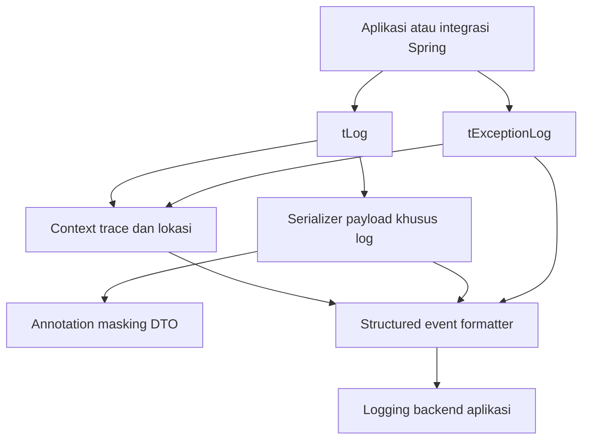

# Plan komponen common logging

> Kontrak aktif: [logging schema 3 dan panduan migrasi](../../backend-common-logging/ENTERPRISE-LOGGING.md), [OpenTelemetry trace/span](../../backend-common-logging/TRACE-CONTEXT.md). Rencana awal di bawah adalah konteks desain; perilaku aktif mengikuti kontrak tersebut.

Status: library mandiri sudah diimplementasikan di [backend-common-logging](../../backend-common-logging/README.md). Integrasi ke repository insurance kantor belum dilakukan karena source target belum tersedia. Targetnya library Java untuk Spring Boot yang membantu investigasi request dan kegagalan insurance backend. Library tetap generik, tanpa aturan bisnis insurance.

## Dua komponen publik

| Komponen | Tanggung jawab | Detail |
|---|---|---|
| `tLog` | Log start, info, validation outcome, dan end; payload tersanitasi; durasi | [Desain tLog](tlog.md) |
| `tExceptionLog` | Log kegagalan, klasifikasi, context, lokasi asal exception, dan stack trace | [Desain tExceptionLog](texception-log.md) |

`tLog1` di BWCE adalah nama instance pemanggilan `tLog`, bukan komponen ketiga. Kedua komponen memakai pendukung internal yang sama: trace context, resolusi class/method, serializer masking DTO, formatter event, dan konfigurasi. [Kontrak bersama](shared-contract.md) menjelaskan pendukung tersebut; [integrasi dan implementasi](implementation.md) menjelaskan pemakaian Spring dan verifikasinya.

## Arsitektur

## Keputusan scope

- API logging cukup dua komponen; nama method/facade di contoh masih usulan.
- Payload request/response dicatat pada boundary yang dipilih setelah masking, tidak diulang di setiap method.
- Class/method otomatis; origin exception terpisah dari lokasi handler. Semua event terkait membawa trace ID.
- Pemanggilan manual menjadi fondasi. Filter, aspect, body advice, dan handler adalah adapter opsional agar lifecycle/error logging tidak perlu ditulis berulang.
- Library tidak menambah retry, mengubah response bisnis, mengelola transaksi, atau membawa domain insurance.
- Logging backend, Java/Spring, MVC/WebFlux, dan client target ditentukan setelah repository insurance diperiksa. Jangan membuat semua adapter sebelum stack diketahui.

## Navigasi

1. [tLog](tlog.md)
2. [tExceptionLog](texception-log.md)
3. [Kontrak bersama: context, payload, format, konfigurasi](shared-contract.md)
4. [Integrasi Spring, tahapan implementasi, dan acceptance](implementation.md)

## Kontrak tracing aktif

Implementasi sekarang memakai traceId/spanId/parentSpanId dan root server span pada setiap request. Detail perilaku, format W3C, header, MDC/async, dan breaking API migration ada di [TRACE-CONTEXT.md](../../backend-common-logging/TRACE-CONTEXT.md); kontrak ini menggantikan rancangan ID awal pada catatan historis implementation plan.
