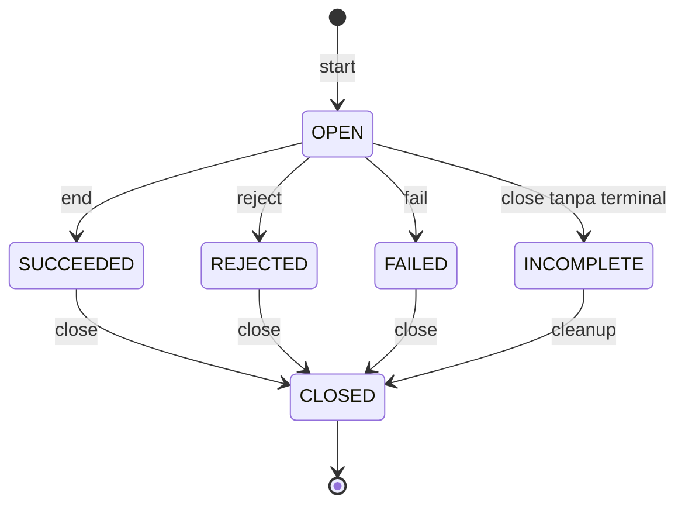

# Implementation plan — tLog dan tExceptionLog

> Kontrak aktif: [logging schema 3 dan panduan migrasi](../../backend-common-logging/ENTERPRISE-LOGGING.md), [OpenTelemetry trace/span](../../backend-common-logging/TRACE-CONTEXT.md). Rencana awal di bawah adalah konteks desain; perilaku aktif mengikuti kontrak tersebut.

[Plan utama](README.md) · [Desain tLog](tlog.md) · [Desain tExceptionLog](texception-log.md) · [Kontrak bersama](shared-contract.md)

Status: implementasi library mandiri tersedia; lihat [panduan dan source](../../backend-common-logging/README.md). Belum diintegrasikan/deploy ke insurance backend kantor. Scope final: satu library JAR logging reusable, dengan dua facade utama. Tidak termasuk refactoring seluruh insurance backend, penggantian kontrak HTTP, atau deployment.

## 1. Keputusan awal dan prasyarat

Nama artifact usulan `backend-common-logging`; class Java `TLog` dan `TExceptionLog`, bean/variable `tLog` dan `tExceptionLog`. Keduanya stateless; state per-request/per-operation disimpan di context terisolasi. Annotation, scope token, dan adapter adalah pendukung, bukan komponen bisnis tambahan.

Repository insurance belum tersedia di workspace. Sebelum membuat build/module, inventaris berikut harus selesai:

| Periksa | Keputusan yang dihasilkan |
|---|---|
| Java, Spring Boot, Maven/Gradle | Baseline kompatibilitas, namespace, struktur module |
| MVC/WebFlux dan cara async | Adapter HTTP/context yang benar; versi awal hanya mendukung stack yang dipilih |
| SLF4J/backend/JSON encoder existing | Cara menulis event tanpa double encoding/appender duplikat |
| Filter, security, advice existing | Urutan hook, pemilik stack trace, response mapping yang dipertahankan |
| Client HTTP dan retry existing | Satu adapter dependency pilot, arti attempt dan logical call |
| DTO style/Jackson configuration | Dukungan field/getter/record, naming strategy, custom serializer |
| Gateway/log platform | Trace header, kebijakan trust, ukuran event, pencarian dan retention |
| Satu endpoint pilot | Baseline response sukses/error, service entry point, dependency, data sensitif |

Hasil tahap ini berupa catatan keputusan singkat di repository target. Tidak perlu menunggu untuk menyepakati API konseptual, tetapi jangan memilih versi dependency atau menjanjikan semua adapter sebelum inventaris.

## 2. Struktur kode kandidat

```text
backend-common-logging/
  src/main/java/<company>/common/logging/
    api/
      TLog.java
      TExceptionLog.java
      LogOperation.java
      LogMetadata.java
    annotation/
      LogPayload.java
      LogMask.java
      LogExclude.java
      LoggedOperation.java
    internal/
      event/         LogEvent, EventType, StructuredEventWriter
      context/       LogContext, ContextScope, ContextSnapshot
      location/      CallerLocationResolver, ErrorOriginResolver
      payload/       PayloadLogSerializer, PayloadResult, MaskStrategy
      error/         ErrorClassifier, FailureContext
    spring/
      configuration/ LoggingProperties, LoggingConfiguration
      web/           TraceFilter, PayloadLoggingAdvice
      operation/     LoggedOperationAspect
      error/         ExceptionLoggingBridge
      integration/   adapter untuk client pilot
  src/test/
```

Nama dan pemecahan class disesuaikan ketika implementasi; jangan membuat interface/provider untuk setiap helper tanpa kebutuhan substitusi nyata. Context/event/payload logic tidak bergantung pada DTO insurance. Consumer memiliki policy kode bisnis, response mapping, dan field/path rules DTO eksternal.

## 3. Kontrak API yang diimplementasikan lebih dahulu

Signature berikut adalah kandidat; finalisasi dengan compiler dan satu consumer contoh:

```java
LogOperation start(String operation);
LogOperation start(String operation, Object inputDto);
void info(String step, String safeMessage);
void info(String step, String safeMessage, LogMetadata metadata);

// LogOperation
void end();
void end(Object outputDto);
void reject(String code, String safeMessage);
void fail(Throwable cause);  // terminal metadata, tanpa stack trace
void close();               // cleanup; bukan implicit success

// TExceptionLog
void error(String operation, Throwable cause);
void error(FailureContext context, Throwable cause);
```

`LogMetadata` memvalidasi field yang diizinkan dan batas ukuran; bukan jalan pintas untuk memasukkan payload mentah. Input DTO Object tetap harus melewati opt-in/policy serializer. `FailureContext` immutable, hanya metadata aman; tidak menyimpan raw DTO. Class/method tidak menjadi parameter wajib developer.

### Contoh manual yang benar

```java
try (LogOperation operation = tLog.start("claim.submit", request)) {
    try {
        ClaimResponse response = claimService.submit(request);
        operation.end(response);
        return response;
    } catch (RuntimeException ex) {
        operation.fail(ex);
        throw ex;
    }
}
```

Catch di contoh hanya menandai terminal failure sebelum cleanup; stack trace dicatat global handler melalui `tExceptionLog`, bukan diulang di sini. Checked exception yang memang dideklarasikan consumer ditangani sesuai signature aslinya. Jangan menambah catch luas pada semua method. Aspect nantinya mengambil alih pola ini pada entry point terpilih.

Untuk expected rejection, panggil `reject` dan jangan `end` sukses. Jika consumer lupa terminal call, `close` mencatat diagnostic incomplete, lalu cleanup. Menutup scope sebelum failure ditandai tidak bisa mengetahui exception secara ajaib; inilah alasan failure harus dicatat di dalam scope.

## 4. Model lifecycle dan context



Terminal event hanya sekali. Pemanggilan terminal ganda tidak mengubah hasil bisnis dan menghasilkan diagnostic aman bila diperlukan. `close` idempotent. Gunakan waktu monotonic untuk durasi dan clock UTC untuk timestamp. Nested scope memulihkan parent; repeated call punya span ID berbeda.

Simpan failure location/context pertama yang paling dekat dengan exception pada request/job-scoped bounded state sebelum scope unwind. Snapshot diteruskan ke handler; jangan memakai mutable flag pada Throwable atau global exception cache. Failure yang dipulihkan tidak boleh mencemari failure context request berikutnya/operasi lain. Boundary harus menghapus state di cleanup; uji multi-failure dan recovery. Jika context tidak tersedia, handler memakai cause-chain origin tanpa mengarang operation.

Manual caller resolution melewati frame helper logging; aspect memberi target invocation metadata langsung. Hindari stack walking bila lokasi sudah diketahui. Error origin memilih frame aplikasi relevan dari cause chain; line hanya jika artifact menyediakan debug information.

## 5. Backlog implementasi berurutan

| ID | Pekerjaan | Output reviewable | Selesai bila |
|---|---|---|---|
| IP-00 | Inventaris target dan pilih pilot | Compatibility notes dan contoh response/log | Stack, boundary ownership, policy data diketahui |
| IP-01 | Setup module/build dan event schema | JAR skeleton, event model, sink adapter | Build memakai baseline consumer, satu event JSON valid |
| IP-02 | Context, ID, lokasi caller | Context scope/snapshot dan resolvers | Nested/thread reuse aman; class/method bukan helper/proxy |
| IP-03 | Implementasikan TLog/token | Start/info/end/reject/fail/close | Lifecycle, durasi, incomplete, terminal dedup benar |
| IP-04 | Annotation dan payload serializer | FULL/LAST_FOUR/exclude, opt-in DTO | Payload aman; DTO/HTTP serialization tidak berubah |
| IP-05 | Implementasikan TExceptionLog | Classifier, origin, safe cause/stack formatting | NPE dan dependency failure jelas; cause utuh; ownership satu stack trace |
| IP-06 | Konfigurasi dan wiring | Bean configuration, limits, override | Consumer bisa inject dua facade; invalid config terdeteksi |
| IP-07 | HTTP lifecycle dan payload pilot | Filter/context + DTO capture hooks | Request/error correlated, payload dedup, response contract tetap |
| IP-08 | Bridge handler dan operation aspect | Integrasi advice existing, annotation entry point | Tidak catch/log ganda; failure snapshot sampai handler |
| IP-09 | Adapter dependency pilot | Request/response DTO dan call outcome log | Target/category/durasi terlihat; retry policy tidak berubah |
| IP-10 | Refactor pilot dan validasi integrasi | Satu endpoint lengkap dan fixture/test | Acceptance scenarios di bawah lulus |
| IP-11 | Consumer kedua dan evaluasi operasional | Contoh reuse, baseline overhead, runbook | Tidak membawa domain pilot; volume/latensi sesuai budget |

Dependency: IP-02/IP-03 memakai IP-01; IP-04 memakai kontrak IP-01; IP-05 memakai context/location dan writer. IP-07 menunggu IP-04/IP-06, IP-08 menunggu IP-05/IP-07, IP-09 menunggu client target diketahui. Setiap task diakhiri review diff dan verifikasi relevan sebelum memperluas scope.

## 6. Aturan payload yang harus diterapkan

- `@LogPayload` menandai tipe DTO yang direview; capture boundary juga harus aktif.
- `@LogMask` FULL menjadi placeholder, LAST_FOUR hanya string yang diizinkan, `@LogExclude` menghapus field dan menang jika annotation konflik.
- Scalar tanpa annotation pada tipe opt-in tampil apa adanya; review field baru wajib. Nested tipe tidak dikenal di-skip, bukan raw serialization.
- Field/getter/record/inheritance mengikuti style target dan diuji. Collection/map/cycle/depth/item count ditangani dengan batas eksplisit.
- Serializer logging terpisah dari mapper HTTP. Tidak ada mutasi object, raw toString fallback, atau module masking yang dipasang global.
- Metadata CAPTURED/TRUNCATED/SKIPPED/FAILED menjelaskan hasil capture. Truncation menghasilkan structured JSON valid dan traversal dibatasi sebelum seluruh object dimaterialisasi.
- Malformed JSON tanpa DTO, binary, file, stream, header secret, dan raw query tidak di-dump. DTO eksternal memakai field/path policy terdaftar.
- Exception message/stack trace memiliki sanitasi tersendiri; annotation DTO tidak melindungi jalur itu.

## 7. Integrasi Spring yang dibangun untuk pilot

| Titik | Implementasi | Batas yang harus diuji |
|---|---|---|
| Request masuk/selesai | Filter/context adapter: ID, response header, start/end, cleanup | Error/async dispatch satu logical lifecycle; before routing lokasi controller belum tersedia |
| DTO HTTP | Body advice/hook sesuai stack | Validation sebelum controller, dedup target DTO, error response, malformed body |
| Service | Aspect `@LoggedOperation` pada entry point | Self-invocation/proxy; tidak mengulang lifecycle manual |
| Error | Bridge ke handler existing | Filter/security/job tidak diasumsikan melewati MVC advice; response committed tidak ditulis ulang |
| Dependency | Satu adapter client pilot | Logical call vs attempt, no raw URL/body, timeout bukan bukti pembatalan downstream |
| Async/job jika dipakai pilot | Context snapshot/completion/error handler | Future return bukan completion; cancellation/interrupt dipertahankan |

Request start/end tetap event transport; DTO payload dapat menjadi event terpisah dengan trace ID sama. Log response DTO berarti response disiapkan, bukan bukti pengiriman sukses. Untuk transaksi, tetapkan urutan advice dan arti end; jika hanya method body, dokumentasikan tanpa mengklaim commit.

Tidak membuat HTTP error response baru dalam library. Existing handler memanggil `tExceptionLog` lalu menggunakan mapper/status existing. Security/filter/job memakai bridge boundary masing-masing. Technical exception diterjemahkan adapter hanya bila menambah makna dan cause dipertahankan.

## 8. Verifikasi per tahap

| Level | Scenario | Evidence yang diharapkan |
|---|---|---|
| Unit core | Sukses/reject/fail/incomplete, terminal ganda, nested scope | Event sequence dan ID/durasi benar; cleanup idempotent |
| Unit location | Manual caller, aspect target, wrapped NPE | Lokasi aplikasi dan origin benar; line boleh absent |
| Unit payload | Null, FULL/LAST_FOUR, exclude, conflict, collection/cycle/unknown type | Tidak ada secret/raw fallback; size terbatas; JSON valid |
| Unit exception | Business/validation/timeout/unexpected, recovered/multiple failures | Kategori dan origin benar; recovery tidak meninggalkan failure state lama |
| Integration HTTP | Sukses, validation, malformed JSON, NPE, committed response | Status/body/header kompatibel; trace konsisten; satu stack trace owner |
| Integration dependency | Timeout, unavailable, invalid response, business rejection, retry existing | Target/durasi/category jelas; logical terminal tidak ganda |
| Integration concurrency | Parallel request, thread reuse, async/error dispatch jika didukung | Tidak ada cross-request context/payload atau lifecycle ganda |
| Compatibility | Payload logger on/off, custom HTTP mapper | DTO dan JSON response bisnis identik |
| Failure injection | Encoder gagal, payload unsupported, sink policy | Original hasil/exception tidak tertutupi; drop/block diketahui |

Gunakan data sintetis, capture appender untuk memeriksa field/event, stub dependency, dan request integration test. Jangan hanya assert string pesan. Tidak perlu membuat pengujian semua client/framework yang belum didukung.

## 9. Definition of done dan delivery

- Satu endpoint pilot dan satu consumer/flow kedua memakai dua facade tanpa dependency domain pilot.
- Operator dapat mencari trace ID, melihat class/method dan urutan proses, membaca payload termasking, membedakan rejection/dependency failure/NPE, serta menemukan frame asal error.
- Satu stack trace per failure yang ditangani; cause chain dan response contract tetap.
- Tidak ada PII/secret mentah pada payload, message, fallback, atau stack trace; batas ukuran dan klasifikasi DTO direview.
- Build/test relevan lulus; batas proxy/async/transaksi dan versi stack ditulis.
- Ukur event count/request, ukuran log, latensi, sink blocking/drop. Budget mengikuti standar kantor dan dicatat sebelum rollout, tidak ditebak.

Deliverable implementasi: source library, tests, contoh konfigurasi, contoh pemakaian manual/annotation, petunjuk adopsi consumer, dan catatan compatibility. Publish package/deploy tidak termasuk tindakan otomatis dari plan ini.

## 10. Rollout dan rollback

Mulai di environment pengujian lalu canary sesuai proses kantor. Aktifkan payload hanya pada boundary/DTO yang direview. Logging emission dan payload punya switch terpisah; mematikan log tidak mematikan cleanup atau response handling. Pantau volume/latensi dan kebocoran data sebelum memperluas adopsi.

Rollback melalui configuration atau versi dependency sebelumnya. Bridge handler di-revert bersama mapping integrasinya bila diperlukan, tanpa mengubah kontrak client. Scope awal tidak memerlukan migrasi data.


## 11. Status eksekusi — 8 November 2026

Baseline prototype: Java release 17, dibuild/ditest dengan JDK 21 dan Spring Boot 3.5.11, Maven 3.9.9. Versi kantor tetap perlu dicocokkan; ini bukan hasil inventaris repository insurance.

| Task | Status hasil |
|---|---|
| IP-00 | Baseline workspace dipilih; inventaris kantor dan endpoint nyata menunggu repository target |
| IP-01–IP-06 | Module JAR, dua facade, context/location, annotation masking, exception logging, dan configuration selesai |
| IP-07–IP-08 | Spring MVC filter/body advice, synchronous aspect, dan bridge handler tersedia; diuji pada consumer fixture |
| IP-09 | Logical dependency wrapper serta interceptor trace RestTemplate/RestClient builder tersedia; stub timeout/header propagation terverifikasi. Metadata status/attempt client kantor belum diadaptasi |
| IP-10 | Pilot sintetis HTTP dengan validation, NPE, dan external timeout selesai; refactoring endpoint kantor belum dilakukan |
| IP-11 | Consumer job terpisah terverifikasi; budget performa, sink kantor, dan production rollout belum dievaluasi |

Verifikasi: 28 tests lulus (0 failures/errors/skipped), termasuk masking tanpa perubahan JSON bisnis, nested/thread context, async mock completion, override configuration, NPE/cause origin, outbound header, dan kegagalan commit transaksi dengan default advice order. Java formatting diperiksa menggunakan Spotless. Build menghasilkan plain JAR, tanpa publish/deploy.

Perbedaan konkret dari rancangan awal: belum ada `LogMetadata` generik karena belum ada consumer yang membutuhkan arbitrary metadata API; logical dependency label menggunakan nama operasi stabil. Error messages mentah sengaja tidak dicetak: log cause types/frames mempertahankan diagnosis tanpa payload sensitif pada message. Suppressed exceptions tidak dicetak. External DTO policy memakai property allowlist langsung; arbitrary path rules belum diimplementasikan. Detail konfigurasi aktual ada di panduan library.


## 12. Consumer integrasi kompleks

Contoh [flow klaim](../../examples/insurance-crud/COMPLEX-FLOW.md) menambah consumer nyata dalam repository contoh: core HTTP, AWS SDK S3 menuju simulator lokal, notification HTTP, H2 journaling, compensation, idempotency, dan reconciliation. Library menambah overload dependency lifecycle terstruktur; API tiga argumen sebelumnya tetap didukung. Total suite saat penambahan ini: 48 tests lulus. Pengujian tidak melibatkan AWS/core kantor; scope production dan keterbatasan H2 tetap seperti dijelaskan pada panduan flow.


## 13. Migrasi trace/span — kontrak aktif schemaVersion 3

Seluruh source library, DTO error, simulator, SDK header, konfigurasi, tests, dan contoh HTTP memakai traceId/spanId/parentSpanId. Root SERVER span sudah ada sejak REQUEST_START, service INTERNAL dan dependency CLIENT menjadi child, serta simulator membuat remote SERVER child. Propagasi memakai W3C traceparent; response X-Trace-ID/X-Span-ID untuk diagnosis. Trace baru dibuat bila header tidak ada/invalid. Sampel request normal tidak memakai ID statis. Context MDC trace/span dipulihkan pada nested scope dan propagation executor. Detail API/migration ada di [TRACE-CONTEXT.md](../../backend-common-logging/TRACE-CONTEXT.md).

Verifikasi tahap ini: 62 tests lulus (42 library + 20 app), termasuk root/payload/span tree, trace generation, invalid/multi headers, future header version, allowlisted propagation, async completion/MDC restoration, serta client/server parent matching HTTP dan AWS SDK ke simulator. Belum ada collector export/tracestate/baggage.


## 14. Payload service lifecycle

Aspect @LoggedOperation sekarang mengirim input DTO opt-in ke PROCESS_START dan masked return value ke PROCESS_END. Default logInput/logResult=true, dengan global payload-enabled tetap wajib. Multiple DTO dibungkus dengan nama parameter; raw scalar/entity unsupported tetap SKIPPED. Void tidak membuat result palsu; exception hanya menghasilkan failure, tanpa successful END. Wrapper Submission pada example klaim sudah opt-in. Pengujian memeriksa kedua payload di CRUD/complex flow, masking tanpa mutasi business response, opt-out, multiargument dan serializer failure yang tidak mengubah hasil bisnis.

Verifikasi payload service lifecycle: 69 tests lulus (49 library + 20 example), tanpa failures/errors/skipped. JAR lokal dan executable example direbuild setelah perubahan.
