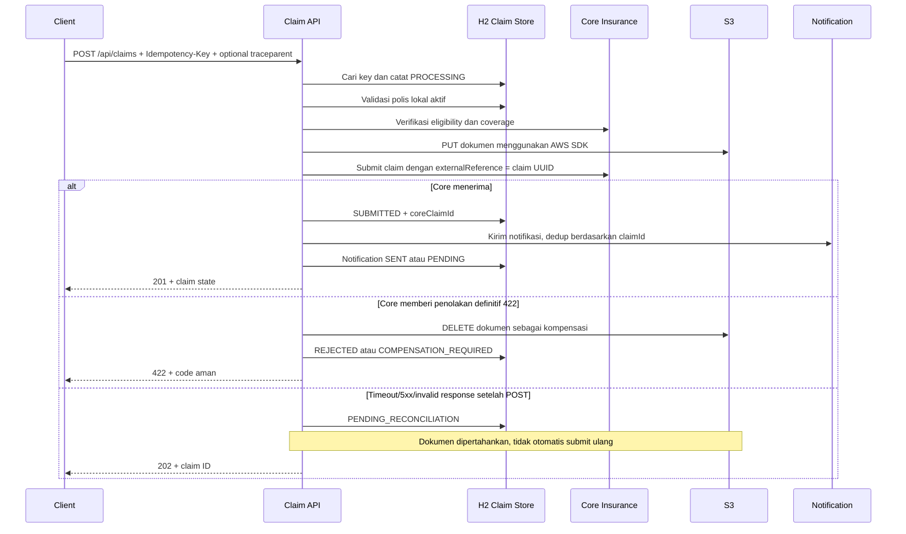

# Flow klaim kompleks: core insurance, S3, database, dan notifikasi

[Panduan aplikasi](README.md) · [Request siap pakai](claims.http) · [Orchestrator](src/main/java/com/example/insurance/claim/ClaimSubmissionService.java) · [Integration tests](src/test/java/com/example/insurance/ClaimFlowIntegrationTest.java)

Contoh ini memakai Java target 17, H2, library tLog/tExceptionLog, client HTTP nyata, dan **AWS SDK S3 2.x**. Default menjalankan simulator core/notification dan subset protokol S3 di localhost:9090. Tidak membutuhkan akun AWS/Docker dan tidak memanggil core kantor atau AWS nyata.

## Jalankan

```sh
./examples/insurance-crud/run.sh
```

Main API: `http://localhost:8080`. Simulator: `http://127.0.0.1:9090`. Jika port simulator terpakai, jalankan `./examples/insurance-crud/run.sh --insurance.demo.port=9091`; endpoint client demo otomatis mengikuti port simulator. Semua state H2 dan simulator hilang ketika proses berhenti.

Buka [claims.http](claims.http) di IntelliJ dan jalankan request berurutan. Request pertama membuat polis aktif melalui CRUD yang sudah ada. File menyediakan claim sukses serta fault core rejection, timeout-after-accept, cleanup failure, dan notification failure. Gunakan idempotency key baru untuk skenario baru; retry request yang sama harus memakai key yang sama.

## Alur utama



Database transaction tidak membungkus seluruh HTTP/S3 call. `ClaimStore` melakukan transaksi pendek yang commit per state change. Local rollback tidak membatalkan operasi remote. Payload Base64 dan description tidak disimpan di claim table; dokumen dikirim ke object storage dengan key UUID tanpa nama pasien.

## Endpoint

| Method | Path | Kontrak |
|---|---|---|
| POST | `/api/claims` | Header Idempotency-Key wajib; request di bawah |
| GET | `/api/claims/{id}` | State klaim yang tersimpan |
| POST | `/api/claims/{id}/reconcile` | Lookup core; finalisasi jika diterima, atau coba notifikasi pending |

```json
{
  "policyNumber": "POL-COMPLEX-123456",
  "amount": 1000.00,
  "claimantEmail": "claimant@example.test",
  "description": "Dokumen klaim sintetis",
  "contentType": "text/plain",
  "documentBase64": "ZGVtby1kb2N1bWVudA=="
}
```

Dokumen maksimal 1 MiB setelah decode; JSON Base64 dibatasi 1.400.000 karakter. Content type demo hanya text/plain dan application/pdf, bukan bukti file sudah divalidasi/malware-scanned. Pemegang polis, email dan policy number dimasking; description dan documentBase64 memakai `@LogExclude`.

Response mencakup `id`, policy number asli untuk consumer, amount, `status`, `notificationStatus`, `coreClaimId`, dan `failureCode`. Masking hanya memengaruhi log.

## Perilaku failure dan idempotency

| Kondisi | HTTP / state | Side effect dan log |
|---|---|---|
| Payload/ID/key/document invalid | 400; belum memanggil dependency | Field/code aman, tidak dump raw body |
| Polis lokal tidak ada/inactive | 404/422; REJECTED | Stop sebelum core/S3 |
| Core verify invalid/unavailable | 502/503; FAILED | Tidak upload atau submit |
| Upload error setelah mungkin menulis | 503; FAILED jika delete berhasil dan hasil upload sudah diketahui, atau COMPENSATION_REQUIRED | Delete idempotent dicoba; primary error tetap dipertahankan |
| Upload timeout/unavailable | 504/503; COMPENSATION_REQUIRED meski delete dijawab sukses | PUT yang masih in-flight bisa selesai belakangan; verifikasi operator diperlukan |
| Core submit menolak 422 | REJECTED atau COMPENSATION_REQUIRED | Cleanup S3; tidak menganggap seluruh external call bisa di-rollback |
| Core POST timeout/5xx/respons invalid | 202; PENDING_RECONCILIATION | Keep dokumen, satu error log pada recovery boundary, tidak blind retry |
| Notification gagal | 201; SUBMITTED + notification PENDING | Klaim core tetap diterima, satu recovery error log |
| Same key + same payload | 200 untuk terminal state, 202 untuk processing/uncertain | Return record lama; tidak upload/submit ulang |
| Same key + different payload | 409 | Tidak membuat klaim kedua |
| Concurrent same key | Satu record melalui unique constraint | Satu remote submission; loser membaca record pemenang |

Saat reconcile menemukan core record, state menjadi SUBMITTED dan notifikasi dikirim bila belum SENT. Bila core lookup 404, state tetap pending: ketiadaan record saat lookup belum cukup untuk menghapus dokumen atau submit ulang. Reconcile tidak mengulang core submission. State COMPENSATION_REQUIRED dan PROCESSING yang tertinggal akibat crash memerlukan operator; belum ada scheduler pembersihan/recovery otomatis.

Key unik dan fingerprint request tersimpan di H2. Replay terminal failure mengembalikan state lama (200), bukan mengulang HTTP failure awal. Ini kontrak contoh yang eksplisit. Tidak ada automatic retry transport; semua client dibatasi timeout. Durasi timeout dapat diatur di `insurance.integrations.read-timeout`.

## Skenario simulator

Simulator admin hanya bind localhost dan hanya ada ketika `insurance.demo.enabled=true`. Ia memakai rule satu kali per operation; rule berikutnya kembali normal. Rules bersifat global di proses demo, jadi jalankan fault scenario berurutan.

```sh
curl -X POST http://127.0.0.1:9090/__demo/faults \
  -H 'Content-Type: application/json' \
  -d '{"operation":"core.submit","fault":"TIMEOUT_AFTER_ACCEPT"}'
```

Kemudian submit klaim dengan key baru. Untuk core rejection gunakan `REJECT`; notifikasi gagal gunakan operation `notification.send` + `UNAVAILABLE`. Cleanup failure: pasang `s3.put` + `ERROR_AFTER_WRITE` dan `s3.delete` + `UNAVAILABLE`, kemudian submit.

Operation yang tersedia: `core.verify`, `core.submit`, `core.lookup`, `s3.put`, `s3.delete`, `notification.send`. Fault yang relevan per operation terlihat di [simulator](src/main/java/com/example/insurance/demo/LocalIntegrationServer.java). `TIMEOUT_AFTER_ACCEPT` core menyimpan record dahulu lalu menunda respons; pada S3 menulis object dahulu lalu menunda respons.

```sh
curl http://127.0.0.1:9090/__demo/state
curl -X POST http://127.0.0.1:9090/__demo/reset
```

State hanya menampilkan count dan trace ID, tanpa document content/email. Reset simulator tidak mereset claim H2; restart aplikasi jika ingin reset seluruh demo. Jangan reset simulator di tengah skenario timeout/reconciliation.

## Apa yang terlihat di log?

```text
REQUEST_START                              traceId=4bf92f3577b34da6a3ce929d0e0e4736
REQUEST_PAYLOAD                            masked DTO, tanpa description/base64
PROCESS_START claim.submit                 class=ClaimSubmissionService method=submit, masked input DTO
PROCESS_START claim.database.create        commit state PROCESSING
PROCESS_START claim.policy.validateLocal
DEPENDENCY_START core.policy.verify        dependency=core-insurance
DEPENDENCY_END   core.policy.verify         durationMs=...
DEPENDENCY_START s3.document.put            dependency=s3, metadata ukuran/key saja
DEPENDENCY_END   s3.document.put
DEPENDENCY_START core.claim.submit          externalReference=UUID
DEPENDENCY_END   core.claim.submit
PROCESS_START claim.database.transition
DEPENDENCY_START notification.claim.send   email dimasking
DEPENDENCY_END   notification.claim.send
PROCESS_END claim.submit                   masked result (claim state + replay)
RESPONSE_PAYLOAD                            masked DTO
REQUEST_END                                status=201
```

Simulator menghasilkan server span `simulator.*` dengan traceId yang sama dan parentSpanId menunjuk client span pemanggil. Outbound HTTP memakai RestTemplate interceptor library, dengan CLIENT span transport di bawah INTERNAL logical dependency. AWS SDK yang belum diinstrumentasi memakai wrapper CLIENT dan header traceparent dari span aktif. Semua span merupakan SDK span yang dapat diekspor; tidak ada exporter jaringan otomatis dan exporter in-memory dipakai test. Host allowlist propagation-hosts berlaku pada interceptor RestTemplate otomatis maupun manual. State simulator menampilkan `traces` dan `spans` untuk memeriksa hubungan tersebut.

Pada failure, `DEPENDENCY_FAILED` menyertakan dependency, span ID, parent ID, category/code, durasi, dan class/method. `TExceptionLog` mencatat cause types/frame sekali pada pemilik boundary, tanpa raw exception message. Jika cleanup dan primary operation sama-sama gagal, dua error berbeda dicatat masing-masing sekali; keduanya tetap satu trace ID. Recovery menangani stack trace di layer recovery, bukan diulang global handler. PROCESS_END orchestrator yang mengembalikan 202 berarti method selesai; bukan klaim sudah diterima core—baca response/status dan event failure dependency.

Info step mempunyai field `step` terpisah dari `operation`, sehingga ID dan nama operasi utama tetap stabil. Database methods diinstrumentasi tanpa SQL/bind parameter atau entity dump.

## Adapter eksternal

Profile [application-external.yml](src/main/resources/application-external.yml) menonaktifkan simulator, mengaktifkan AWS default credentials provider, serta membutuhkan CORE_INSURANCE_URL, NOTIFICATION_URL, AWS_REGION, S3_BUCKET. Host dependency eksternal perlu dimasukkan ke `backend.common.logging.propagation-hosts` agar header diteruskan. Bucket harus sudah ada; aplikasi tidak membuat bucket atau mengubah policy.

Ini titik wiring untuk lingkungan nyata, bukan implementasi kontrak core kantor yang sudah disertifikasi. Endpoint core harus mendukung externalReference yang idempotent dan lookup; notification provider harus mendukung dedup claimId agar retry tidak menggandakan pesan. S3 endpoint override opsional untuk emulator/compatible endpoint yang sesuai.

Referensi API SDK: [endpoint override/path style](https://docs.aws.amazon.com/sdk-for-java/latest/developer-guide/endpoint-config.html) dan [API/attempt timeout](https://docs.aws.amazon.com/sdk-for-java/latest/developer-guide/timeouts.html). Default demo memakai static credentials sintetis untuk simulator; tidak membaca credential AWS pengguna.

## Batas contoh

Simulator S3 hanya implementasi minimal PUT/DELETE yang diperlukan SDK di contoh; tidak menguji IAM, signature validation, region redirect, multipart, checksum production, atau semua perilaku AWS. Tidak ada AWS/core kantor yang dipanggil selama verifikasi. Pengujian integration memakai HTTP localhost nyata dan AWS SDK menuju simulator tersebut.

State H2/demo volatile, belum ada outbox, auth/ownership tenant, scheduler reconciliation, atau recovery crash lintas proses. Setelah remote accepted tetapi state commit gagal, record bisa tertinggal PROCESSING; log sebelumnya membantu investigasi, tetapi recovery durable perlu desain production terpisah. Jangan menyamakan contoh ini dengan exactly-once guarantee lintas sistem. Lingkup “semua log” adalah boundary flow yang diinstrumentasi, bukan semua method/helper, network error tak teramati, atau bukti sink log tak pernah kehilangan event.


## Hasil verifikasi lokal

Suite library/CRUD/flow kompleks dan server servlet nyata juga memverifikasi exported SDK spans serta encoder JSON message; lihat report Maven untuk jumlah dan hasil terbaru. Suite kompleks memakai HTTP localhost nyata untuk core/notification dan AWS SDK untuk S3 PUT/DELETE; byte dokumen yang diterima simulator diperiksa persis sama dengan input. Pengujian mencakup trace lintas boundary, parent span ID, masking/no document dump, concurrent idempotency, core rejection, upload error/timeout, cleanup failure, unknown submission outcome, lookup sementara 404, notification recovery, dan input invalid. Build/runtime lokal JDK 8, source dan dependencies diuji pada Boot 2.4.3/2.4.4.

Kontrak payload field/parameter dan pengaturan produksi: [schema 3](../../backend-common-logging/ENTERPRISE-LOGGING.md). DTO field tanpa aturan tidak masuk log; external profile payload default false.
